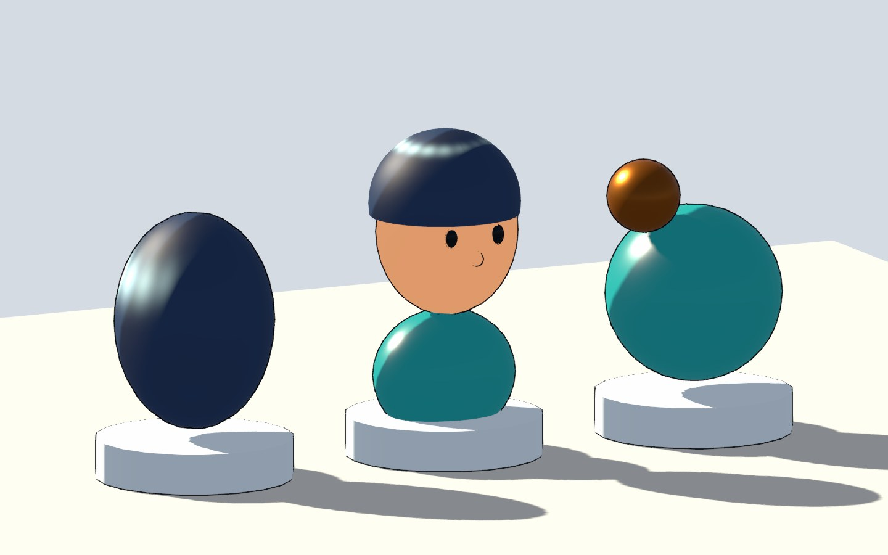

# GZtoon Preview

面向 Unity 6.3 / URP 17.3 的角色着色预览版，提供完整漫反射 Ramp、基础 PBR、脸部 SDF、头发 UV 高光、描边与基础后处理。

Character shading for Unity URP with a full diffuse Ramp workflow, standard material maps, face SDF and UV-driven hair highlights.

[项目页面](https://gz-beverage.github.io/GZtoon-Preview/) · [下载版本](https://github.com/Gz-beverage/GZtoon-Preview/releases) · [反馈问题](https://github.com/Gz-beverage/GZtoon-Preview/issues)



## 安装

在 Unity 的 Package Manager 中选择 **Install package from git URL**，输入下面的地址。

```text
https://github.com/Gz-beverage/GZtoon-Preview.git#v0.1.0-preview.1
```

开发分支地址使用 `#main`。也可下载仓库 ZIP，解压后通过 Package Manager 的 **Install package from disk** 选择 `package.json`。

目标环境为 Unity `6000.3`、URP `17.3.0`、Linear 色彩空间。验证环境为 Windows / Direct3D 12，覆盖 RenderGraph 与 Compatibility Mode。

## 创建材质

在 Project 窗口中选择 **Create → GZtoon Preview → Base / Face / Hair Material**。

| 入口 | 用途 |
|---|---|
| `GZtoon/Preview/Base` | 身体、服装、普通表面，基础 PBR 和完整漫反射 Ramp |
| `GZtoon/Preview/Face` | 共享基础着色，增加通用 SDF 明暗计算 |
| `GZtoon/Preview/Hair` | 共享基础着色，增加 UV 遮罩高光 |

材质 Inspector 顶部可以切换用途。参数按底色、PBR、漫反射、头部功能、环境光与描边分组。

## 漫反射 Ramp

- 起点与终点重映射半兰伯特。两者相等时使用硬阈值。
- 非 Ramp 阴影颜色控制普通直接漫反射暗部。
- 明暗分级图提供通道、反转、重映射、强度与偏移。
- Ramp 使用显式 LOD 0，并支持固定 Y 和 Y 贴图。
- Y 贴图支持通道选择、反转和纵向范围映射。
- 区域遮罩控制普通漫反射与颜色 Ramp 的混合，白色使用 Ramp。
- 静态 IGN 抖动按 Ramp 纹素控制幅度，强度 1 对应约正负半个纹素。
- 颜色校正提供曝光、色相、饱和度、对比度、Gamma 和染色。

默认 Ramp 含四组色带，可以调整固定 Y 观察冷、暖与柔和的暗部。法线、粗糙度、金属度和 AO 采用基础材质输入，GGX 与环境反射使用 URP 的着色函数。

## 贴图约定

| 贴图 | 导入与通道 |
|---|---|
| 底色 | sRGB，A 用于裁剪 |
| 法线 | Unity Normal map，普通切线空间法线 |
| 粗糙度、金属度、AO | Linear，通过 RGBA 通道向量选择读取值 |
| Ramp | Linear、Clamp，推荐关闭 mipmaps |
| SDF、分级图、遮罩 | Linear |
| UV 高光控制图 | Linear，RG 为缩放、BA 为平移 |

通道向量 R 为 `(1,0,0,0)`，G 为 `(0,1,0,0)`，B 为 `(0,0,1,0)`，A 为 `(0,0,0,1)`。数值贴图的默认读取通道见材质面板。

## 脸部 SDF

1. 创建 Face 材质并指定 SDF 贴图及通道。
2. 给头部物体添加 **Preview Head Basis** 组件。
3. 指定头部 Transform，并把脸部 Renderer 加入 Targets。
4. 让头部局部 `+Z` 对应脸部朝向、`+X` 对应角色右侧，按模型需要设置镜像。
5. 调整明暗偏移与柔软度，柔软度 0 对应硬边。

光向在头部平面中决定左右镜像与 SDF 阈值，结果进入共用的漫反射 Ramp。头部正上方和正下方使用垂直方向的稳定过渡。

## 头发 UV 高光

指定高光遮罩和通道，通过 UV 缩放、平移、视角位移、偏移和颜色强度调整形状。开启 UV 控制图后，图中 RG 和 BA 分别调节每个位置的缩放与平移。高光遮罩的白色区域产生高光，反转开关可以调换。

## 原生阴影、描边与后处理

阴影使用 URP 的投射和接收流程。在 URP Asset 与 Light 中配置主光、附加灯和软阴影。

描边安装入口为 **Tools → GZtoon Preview → Install Outline on Current Renderer**，材质中控制宽度与颜色。宽度采用世界单位。

基础后处理入口为 **Tools → GZtoon Preview → Create Basic Post-processing Volume**。它创建一个包含 Bloom、Neutral Tonemapping、Color Adjustments 的 URP Volume Profile，并为 Main Camera 开启后处理与 FXAA。曝光、对比度和饱和度通过原生 Volume Inspector 调整。

## 示例场景

在 Package Manager 的 Samples 中导入 **Basic Demo**，打开 `BasicDemo.unity`。示例包含生成的材质、程序化头发网格、基础后处理和 `DemoPipeline.asset`。可以将示例管线指定到项目的 Graphics / Quality 设置，也可以在现有 Renderer 上安装描边 Feature。

页面效果图来自这个场景的 Unity 渲染。示例模型与贴图通过程序生成。

## 源码

```text
Shaders/       三个材质入口、共用输入、光照和辅助 Pass
Runtime/       描边 Renderer Feature、头部坐标绑定
Editor/        材质面板、材质创建、描边与后处理配置
Textures/      默认 Ramp 与示例遮罩
Samples~/      基础演示场景及材质
docs/          项目介绍页面
```

代码使用 MIT License。Unity URP 通过 Package Manager 引用，其许可与署名见 `Third Party Notices.md`。

