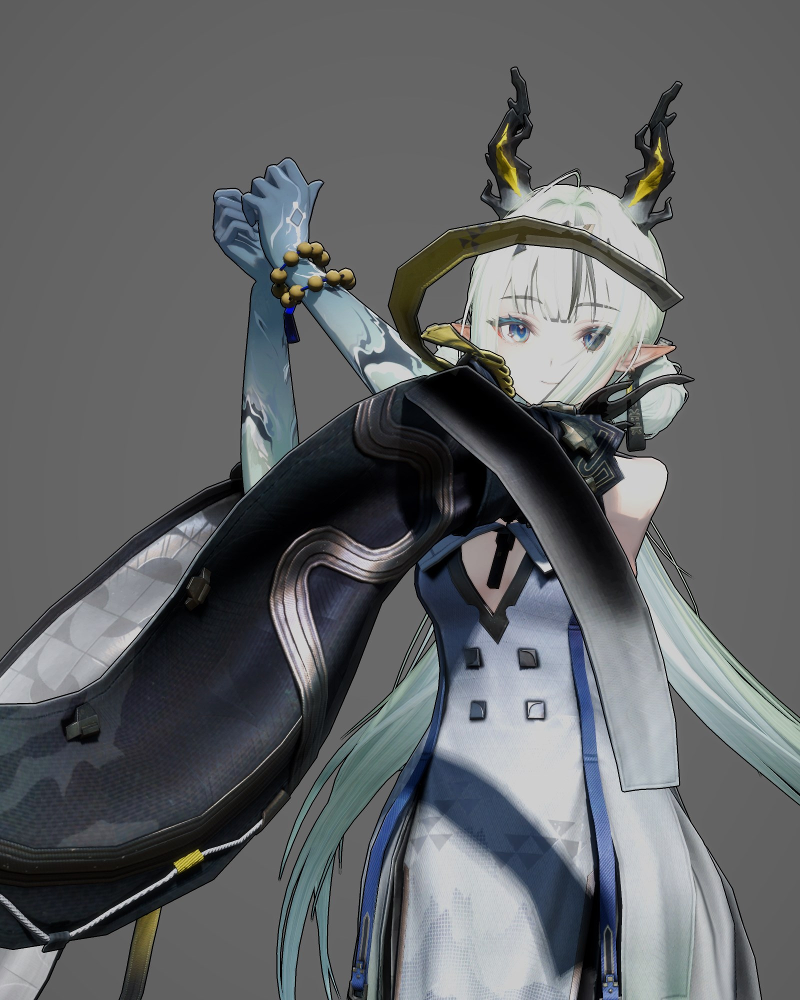

# GZtoon

面向 Unity 6.3 / URP 17.3 的风格化角色渲染体系，围绕 PBR、漫反射 Ramp、脸部 SDF、眼睛、头发、角色阴影与后处理组织材质流程。

本页介绍 **GZtoon 完全版**的功能与渲染能力。当前公开发布的安装包为 **GZtoon Preview 预览版**，包内功能和安装步骤见下方的“Preview 预览包”部分。

Stylized character rendering for Unity URP. Full-edition feature overview with a downloadable Preview package.

[下载 Preview](https://github.com/Gz-beverage/GZtoon-Preview/releases) · [Preview 安装与使用](#preview-预览包) · [反馈问题](https://github.com/Gz-beverage/GZtoon-Preview/issues)

## 渲染展示

祀 · GZtoon 主版在 Unity 6.3 / URP 17.3 中的实际渲染。更多近景与全身图见[展示页](https://gz-beverage.github.io/GZtoon-Preview/)。



## 完全版功能

### 材质用途与 Shader 入口

按角色部位组织独立入口，共用材质输入、光照实现和编辑器配置。

| 用途 | 入口与能力 |
|---|---|
| 基础 PBR | `GZ/GZtoon`，普通表面、PBR 贴图、漫反射 Ramp、描边与透明度控制 |
| 身体 | `GZ/GZtoon Body`，皮肤、服装、厚度背光与风格化高光 |
| 脸部与眼睛 | `GZ/GZtoon Face`，脸部 SDF、区域控制、眼睛分区与专用材质响应 |
| 头发 | `GZ/GZtoon Hair`，发丝高光、UV 高光、暗线与头发方向法线 |
| 丝袜 | `GZ/GZtoon Stockings`，KM 透肤、区域遮罩与独立法线 |
| 综合入口 | `GZ/GZtoon Compatible`，集中提供各部位功能，支持用途切换与材质配置集合 |
| 扩展材质 | GZtoon Lit 物理材质与 Shell 绒毛材质、绒毛渲染组件 |

各入口根据用途提供相应功能。材质面板按功能分组，预设与用途切换共用同一套材质状态同步。

### 基础表面与贴图

- 底色、细节底色、HDR 染色与独立 UV 平铺、偏移。
- 普通切线空间法线、混合法线，以及可选的 RG 双通道法线扩展。
- 头发可从共用贴图 BA 读取方向法线，并单独调整强度。
- 粗糙度、金属度和 AO 支持贴图通道选择、反转、强度与重映射。
- 直接光与间接光可共用表面粗糙度，组织统一的材质响应。

### 漫反射、Ramp 与暗部

- 半兰伯特、XZ 方向受光、明暗起终点与局部分级图。
- 完整漫反射颜色 Ramp，提供区域遮罩、固定行、贴图选行与行偏移。
- Ramp 使用显式 LOD 0 查表，提供静态 IGN 抖动与幅度控制。
- 向上补光、底光保护、皮肤厚度背光与阴影边缘透色。
- 暗部颜色 LUT、明暗颜色和独立调色，便于组织不同材质的阴影色。

### 高光与环境反射

- GGX 直接高光与 GGX 改模式，提供 IOR、金属度、粗糙度、颜色和强度控制。
- 各向异性 GGX、Blinn–Phong、独立副高光与高光颜色 Ramp。
- 清漆层、自定义清漆环境反射、MatCap 及其遮罩、法线和暗部弱化。
- 反射探针、自定义 Cubemap、环境采样方向与间接镜面反射调节。
- FGD 环境 BRDF 查找表和对应的编辑器烘焙工具。

### 间接光与 GI

- SH 环境漫反射与 SH Ramp。
- 环境漫反射抹平及区域遮罩，环境亮度范围控制。
- 漫反射 GI 融合、亮部 GI 抑制、间接漫反射和间接高光 AO。
- 多组独立颜色校正，提供曝光、色相、饱和度、对比度、Gamma 与 HDR 染色。

### 脸部与眼睛

- 通用与终末地脸部 SDF 模式，共用头部前、右、上方向。
- SDF 贴图通道、UV 来源、镜像、偏移、柔软度，以及脸部与皮肤过渡。
- Face AO、鼻部高光、脸部区域控制、表情叠图与贴花。
- 虹膜视差、眼睛散射、半球 MatCap 与 Alpha 加色。
- 虹膜、巩膜、角膜和眼睑遮蔽分区，提供分区染色、粗糙度与高光控制。
- 眼睛复用脸部 SDF。普通半兰伯特路径提供头部前向与球形代理方向的受光法线修正。
- 头部坐标组件同步脸部与眼睛材质，支持动画更新和品质材质切换。

### 头发

- 单峰发丝高光与可选 UV 贴图高光。
- 发丝方向、分区偏移、视角衰减与二维高光 LUT。
- 发丝暗线的区域、方向、锐度与高光亮区恢复。
- 头发表面 Stencil、头发／眉毛区域控制与独立刘海阴影网格。
- 底色 Alpha、Alpha 修正贴图与前发视角透明度控制。

### 皮肤、丝袜与表面效果

- 皮肤厚度背光，通过厚度贴图和区域遮罩调整透光响应。
- KM 丝袜透肤，提供厚度、皮肤底色混合、区域遮罩和独立法线。
- 表面视角染色，可用于身体、皮肤和其他需要视角颜色变化的材质。
- 双采样闪点、RGBA 分层调色、视差与滚动，以及阴影和 AO 响应。
- 多层自发光、菲涅尔边缘光与深度边缘光。

### 透明度、描边与补绘

- 不透明、Alpha 裁剪与透明表面设置，提供整体不透明度和透明投影控制。
- Alpha 修正贴图支持替换、相乘、相加、相减、通道选择、反转和 UV 调整。
- 顶点外扩描边，提供宽度、颜色、平滑法线来源、深度偏移与 Stencil 设置。
- 通用 Renderer 补绘组件，通过材质和子网格列表提交额外绘制。

### 灯光、阴影与屏幕空间效果

- 主光、附加方向光、点光和聚光共用逐灯材质响应。
- 附加光提供独立开关、强度、风格化硬边与近光源亮度钳制。
- URP 原生阴影、角色自阴影、接触软化及刘海自阴影区域遮罩。
- GTAO，提供质量、半径、时域与空间滤波等控制。
- Hi-Z 屏幕空间反射 SSR，提供材质接收开关、粗糙度响应、质量设置和一键配置。
- 共享几何输入供 GTAO、SSR 与后处理消费，复用深度、法线和角色遮罩资源。

主材质通过 URP 前向／ForwardOnly Pass 完成逐灯着色。屏幕空间效果通过对应 Renderer Feature 和 Volume 配置。

### 后处理与画面风格

- 柔光扩散、背景透光、暗部晕染与画面渐变补光。
- 屏幕描边、深度边缘光、锐化和径向模糊。
- 场景／皮肤泛光、金属十字闪耀与八向星芒。
- AgX、UE4 Film ACES、参考风格后处理与颜色调整。
- 黑白闪、冲击帧与相机参数关键帧控制。
- 角色范围和材质范围筛选，配合单功能与整体预设组织画面。

### 工具、预设与品质管理

- GZtoon 工具箱集中管理材质、贴图、烘焙、组件、效果配置与维护工具。
- RGBA 连线式通道编辑，提供多贴图输入、单通道预览、合成预览和法线数值转换。
- 漫反射／高光 Ramp 编辑器，以及 FGD、平滑描边法线、球形法线和 GI 抹平遮罩烘焙。
- 顶点色绘制、批量贴图处理和游戏贴图通道适配。
- 整体材质、部位、光照、透明度、Ramp／FGD 与后处理预设。
- 角色高／中／低品质材质配置，按占屏高度切换，并控制绒毛壳层数量。
- Shader 预编译、构建功能清单、工程配置诊断、材质引用快照与旧属性迁移。

## Preview 预览包

当前公开安装包为 `com.gztoon.preview`，版本 `0.1.0-preview.1`。

Preview 提供 Base、Face、Hair 三个入口，包含完整漫反射 Ramp、基础 PBR 贴图、通用脸部 SDF、UV 头发高光、描边与 URP 原生基础后处理。以下说明对应这个可下载的预览包。

### 安装

在 Unity 的 Package Manager 中选择 **Install package from git URL**，输入下面的地址。

```text
https://github.com/Gz-beverage/GZtoon-Preview.git#v0.1.0-preview.1
```

开发分支地址使用 `#main`。也可下载仓库 ZIP，解压后通过 Package Manager 的 **Install package from disk** 选择 `package.json`。

目标环境为 Unity `6000.3`、URP `17.3.0`、Linear 色彩空间。验证环境为 Windows / Direct3D 12，覆盖 RenderGraph 与 Compatibility Mode。

### 创建材质

在 Project 窗口中选择 **Create → GZtoon Preview → Base / Face / Hair Material**。

| 入口 | 用途 |
|---|---|
| `GZtoon/Preview/Base` | 身体、服装、普通表面，基础 PBR 和完整漫反射 Ramp |
| `GZtoon/Preview/Face` | 共享基础着色，增加通用 SDF 明暗计算 |
| `GZtoon/Preview/Hair` | 共享基础着色，增加 UV 遮罩高光 |

材质 Inspector 顶部可以切换用途。参数按底色、PBR、漫反射、头部功能、环境光与描边分组。

### 漫反射 Ramp

- 起点与终点重映射半兰伯特。两者相等时使用硬阈值。
- 非 Ramp 阴影颜色控制普通直接漫反射暗部。
- 明暗分级图提供通道、反转、重映射、强度与偏移。
- Ramp 使用显式 LOD 0，并支持固定 Y 和 Y 贴图。
- Y 贴图支持通道选择、反转和纵向范围映射。
- 区域遮罩控制普通漫反射与颜色 Ramp 的混合，白色使用 Ramp。
- 静态 IGN 抖动按 Ramp 纹素控制幅度，强度 1 对应约正负半个纹素。
- 颜色校正提供曝光、色相、饱和度、对比度、Gamma 和染色。

默认 Ramp 含四组色带，可以调整固定 Y 观察冷、暖与柔和的暗部。法线、粗糙度、金属度和 AO 采用基础材质输入，GGX 与环境反射使用 URP 的着色函数。

### 贴图约定

| 贴图 | 导入与通道 |
|---|---|
| 底色 | sRGB，A 用于裁剪 |
| 法线 | Unity Normal map，普通切线空间法线 |
| 粗糙度、金属度、AO | Linear，通过 RGBA 通道向量选择读取值 |
| Ramp | Linear、Clamp，推荐关闭 mipmaps |
| SDF、分级图、遮罩 | Linear |
| UV 高光控制图 | Linear，RG 为缩放、BA 为平移 |

通道向量 R 为 `(1,0,0,0)`，G 为 `(0,1,0,0)`，B 为 `(0,0,1,0)`，A 为 `(0,0,0,1)`。数值贴图的默认读取通道见材质面板。

### 脸部 SDF

1. 创建 Face 材质并指定 SDF 贴图及通道。
2. 给头部物体添加 **Preview Head Basis** 组件。
3. 指定头部 Transform，并把脸部 Renderer 加入 Targets。
4. 让头部局部 `+Z` 对应脸部朝向、`+X` 对应角色右侧，按模型需要设置镜像。
5. 调整明暗偏移与柔软度，柔软度 0 对应硬边。

光向在头部平面中决定左右镜像与 SDF 阈值，结果进入共用的漫反射 Ramp。头部正上方和正下方使用垂直方向的稳定过渡。

### 头发 UV 高光

指定高光遮罩和通道，通过 UV 缩放、平移、视角位移、偏移和颜色强度调整形状。开启 UV 控制图后，图中 RG 和 BA 分别调节每个位置的缩放与平移。高光遮罩的白色区域产生高光，反转开关可以调换。

### 原生阴影、描边与后处理

阴影使用 URP 的投射和接收流程。在 URP Asset 与 Light 中配置主光、附加灯和软阴影。

描边安装入口为 **Tools → GZtoon Preview → Install Outline on Current Renderer**，材质中控制宽度与颜色。宽度采用世界单位。

基础后处理入口为 **Tools → GZtoon Preview → Create Basic Post-processing Volume**。它创建一个包含 Bloom、Neutral Tonemapping、Color Adjustments 的 URP Volume Profile，并为 Main Camera 开启后处理与 FXAA。曝光、对比度和饱和度通过原生 Volume Inspector 调整。

### 示例场景

在 Package Manager 的 Samples 中导入 **Basic Demo**，打开 `BasicDemo.unity`。示例包含生成的材质、程序化头发网格、基础后处理和 `DemoPipeline.asset`。可以将示例管线指定到项目的 Graphics / Quality 设置，也可以在现有 Renderer 上安装描边 Feature。

Basic Demo 示例图来自这个场景的 Unity 渲染。示例模型与贴图通过程序生成。


### 源码

```text
Shaders/       三个材质入口、共用输入、光照和辅助 Pass
Runtime/       描边 Renderer Feature、头部坐标绑定
Editor/        材质面板、材质创建、描边与后处理配置
Textures/      默认 Ramp 与示例遮罩
Samples~/      基础演示场景及材质
docs/          展示图片与静态文档
```

代码使用 MIT License。Unity URP 通过 Package Manager 引用，其许可与署名见 `Third Party Notices.md`。

